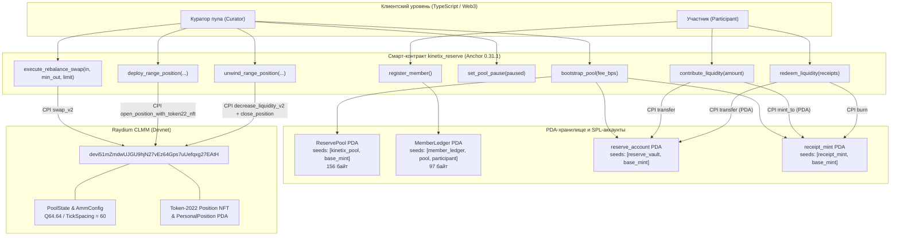

# Kinetix Reserve — Инженерный комплекс по разработке на Solana (Недели 3–13)

Репозиторий содержит последовательный цикл практических модулей по программированию в среде Solana Virtual Machine (SVM), а также сквозной DeFi-протокол **Kinetix Reserve** — программируемое казначейство с квитанционным учетом долей, защитой от инфляционных атак и интеграцией с пулами концентрированной ликвидности **Raydium CLMM** на сети Devnet.

---

## Архитектура сквозного протокола «Kinetix Reserve»



---

## Состав репозитория

### Фундаментальные модули (Недели 3–7 и практика RPC)

| Модуль | Директория | Назначение и ключевые механизмы |
| :--- | :--- | :--- |
| Неделя 3 | [`week03_svm_ledger/`](./week03_svm_ledger/) | Консольный симулятор расчетного реестра SVM на Rust: сериализация Borsh, `SimAccount`, разделение мутабельных срезов `split_at_mut`, контроль квот и `checked_add`/`checked_sub`. |
| Неделя 4 | [`week04_native_beacon/`](./week04_native_beacon/) | Нативный смарт-контракт телеметрии на `solana-program` (`BeaconRecord`), проверка владельца аккаунта и клиентская отправка транзакций. |
| Неделя 5 | [`week05_anchor_quorum/`](./week05_anchor_quorum/) | Программа голосования и кворума на Anchor (`ProposalTally`), защита от underflow при отзыве голоса и контроль доступа `has_one = curator`. |
| Неделя 6 | [`week06_pda_registry/`](./week06_pda_registry/) | Реестр паспортов узлов на базе детерминированных PDA (`[b"node-passport", owner]`), обновление репутации и возврат залога аренды через `close = owner`. |
| Неделя 7 | [`week07_spl_asset/`](./week07_spl_asset/) | Полный жизненный цикл токена `KTX` (`6 decimals`): инициализация Mint, привязка метаданных Metaplex V3, эмиссия 250 000 KTX, перевод и аудит балансов. |
| Практика RPC | [`helius_rpc_lab/`](./helius_rpc_lab/) | Работа с выделенным узлом Helius Devnet RPC: атомарный перевод SOL с Memo-тегом и жизненный цикл токена `KTXLAB` (эмиссия, распределение, сжигание). |

### Сквозной проект «Kinetix Reserve» (Недели 8–13)

| Этап | Директория | Реализованная функциональность |
| :--- | :--- | :--- |
| Неделя 8 | [`week08_reserve_core/`](./week08_reserve_core/) | Каркас `ReservePool` (156 B) и `MemberLedger` (97 B), деривация PDA хранилища и минта квитанций. |
| Неделя 9 | [`week09_liquidity_intake/`](./week09_liquidity_intake/) | Инструкция `contribute_liquidity` с виртуальным смещением `VIRTUAL_OFFSET = 1000` против инфляционных атак и CPI-чеканкой квитанций. |
| Неделя 10 | [`week10_redemption_cpi/`](./week10_redemption_cpi/) | Инструкция `redeem_liquidity` (сжигание квитанций, вывод через PDA signer, удержание комиссии `fee_bps`) и аварийная пауза `set_pool_pause`. |
| Неделя 11 | [`week11_clmm_bootstrap/`](./week11_clmm_bootstrap/) | Выпуск пары `KTX-A` / `KTX-B`, каноническая сортировка `mint_0 < mint_1`, расчет `sqrt_price_x64` и тиков `[-600, +600]` (`tick_spacing = 60`). |
| Неделя 12 | [`week12_clmm_router/`](./week12_clmm_router/) | Инструкция `execute_rebalance_swap`: CPI в `raydium_clmm_cpi::cpi::swap_v2` с порогом проскальзывания и ценовым лимитом `sqrt_price_limit_x64`. |
| Неделя 13 | [`week13_clmm_positions/`](./week13_clmm_positions/) | Инструкции `deploy_range_position` и `unwind_range_position` (Token-2022 Position NFT, сбор комиссий, оценка Impermanent Loss). |
| Финал | [`kinetix_reserve/`](./kinetix_reserve/) | Объединенный смарт-контракт протокола, полный набор модульных и интеграционных тестов и сценарии для Devnet. |

---

## Математическая модель

1. **Выпуск квитанций (Неделя 9):**
   $$\text{Receipts} = \left\lfloor \frac{\text{Amount} \cdot (\text{IssuedReceipts} + 1000)}{\text{ManagedAssets} + 1000} \right\rfloor$$

2. **Погашение с удержанием комиссии выхода (Неделя 10):**
   $$\text{GrossAssets} = \left\lfloor \frac{\text{ReceiptsBurned} \cdot (\text{ManagedAssets} + 1000)}{\text{IssuedReceipts} + 1000} \right\rfloor, \quad \text{Fee} = \left\lfloor \frac{\text{GrossAssets} \cdot \text{fee\_bps}}{10000} \right\rfloor$$
   $$\text{NetAssets} = \text{GrossAssets} - \text{Fee}$$

3. **Дискретизация цены в Raydium CLMM (Неделя 11):**
   $$P(i) = 1.0001^i, \quad \text{SqrtPriceX64} = \left\lfloor \sqrt{P} \cdot 2^{64} \right\rfloor$$

4. **Непостоянные потери при изменении цены $k = P_1 / P_0$ (Неделя 13):**
   $$IL(k) = \frac{2\sqrt{k}}{1 + k} - 1$$

---

## Проверка и запуск

Для сборки на Windows при наличии нелатинских символов в пути рекомендуется задать каталог сборки `CARGO_TARGET_DIR`:

```powershell
$env:CARGO_TARGET_DIR = "C:\temp\cargo_target"
cd kinetix_reserve
cargo test
```

Отчетная документация размещена в корневом файле `Отчет_по_курсу_Solana_Kinetix_Reserve.docx`.
